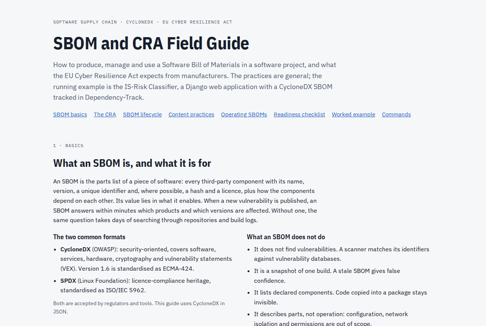

# IS-Risk Classifier

**English** · [Deutsch](README.de.md)

Lightweight risk register: separates IT risks from information security risks (IS risks) by the
affected protection goals and the origin, computes the risk score R = P × I and escalates critical
IS risks to the incident response team.

> [!WARNING]
> **Study project, not for production use.** The IS-Risk Classifier is neither complete nor
> independently reviewed. It is not meant for real risk data. The limitations are listed below.

## Origin, purpose and limitations

**Origin.** The project was built in the IT security degree programme at Technische Hochschule
Brandenburg (Brandenburg University of Applied Sciences) for two courses:

- **Software Engineering** (*Softwaretechnik*, summer term 2026): requirements as user stories with
  acceptance criteria (US-01 to US-04, AK-xx.x) and the UML model. The functional specification
  comes from there.
- **Secure Software Development** (*Entwicklung sicherer Softwaresysteme*, winter term 2026/27):
  threat analysis following NIST SP 800-154 with the attack vectors T-01 to T-10 and the security
  controls M-01 to M-10 (hand-in 1), and the security requirements with test scenarios derived from
  them (hand-in 2). The identifiers in code and tests (`@pytest.mark.req("M-05")`) refer to these
  assignments.

**Purpose.** The application is the subject of these analyses. It shows that the requirements and
security controls can be implemented and tested. Tests exist for the acceptance criteria of US-01 to
US-03, the invariants INV-02 and INV-03 and the security controls M-01 to M-10, mapped in
[`docs/traceability.md`](docs/traceability.md). It is not a product.

**How it was made.** Requirements, model, analyses and decisions come from the course assignments.
The code was largely generated with Claude Code (Anthropic, model Claude Opus 5.5).

**Limitations** (as of 23 October 2026):

- **No security audit.** There has been neither an independent review nor a penetration test. The
  security controls are only as good as the threat analysis and their tests.
- **Dependencies with known vulnerabilities:** on 22 October 2026, `make audit` reported findings in
  `pillow` 12.3.0 and `certifi` 2026.7.22. Fixed versions exist but are not applied yet.
- **Sign-in for development only:** Keycloak runs with demo accounts that share one demo password,
  without two-factor authentication and without a password policy. Without a TLS proxy in front,
  everything runs over HTTP on `localhost`.
- **Open requirements from hand-in 2:** administration still sees the whole register instead of
  only the identifier and the delivery status. Findings of the dependency audit cannot be deferred
  with an expiry date. An export without matches produces an empty file instead of a message.
- **No real delivery:** `notify-gateway` is a placeholder. E-mails end up in Mailpit, text messages
  only in the log.
- **No running CI:** the workflow `.github/workflows/ci.yml` is in place, but GitHub Actions is
  disabled for the repository. Dependabot runs.
- **Sample data:** risks, assets and accounts are fictitious.

## Getting started

Requirements: Docker with Compose and `make`. Everything else runs in containers.

```bash
git clone https://github.com/mwagner86/is-risk-classifier.git && cd is-risk-classifier
```

```bash
make dev
```

Then open <http://localhost:8000> (or <http://127.0.0.1:8000>) and sign in with one of the demo
accounts below — not with `admin`, which is only the account of the Keycloak administration. On the
first start, `make dev` creates the file `.env` with random secrets. The password of the demo
accounts is stored there as `DEMO_USER_PASSWORD`:

```bash
grep ^DEMO_USER_PASSWORD= .env
```

| Account | Role |
| --- | --- |
| `melder` | Risk reporter (NUTZER) |
| `rm.mueller`, `rm.schmidt` | Risk manager — two of them, for the four-eyes principle (M-04) |
| `ciso` | CISO |
| `app-admin` | Administration |
| `ohne-rolle` | no role — sign-in is rejected |

## Commands

| Command | Effect |
| --- | --- |
| `make dev` | build and start the stack (app, worker, stylesheet, PostgreSQL, Keycloak), fill an empty register with sample data |
| `make seed` | create sample data, only if the register is empty (also part of `make dev`) |
| `make css` | build the minified stylesheet once |
| `make prod` / `make prod-down` | production-like stack: runtime image with gunicorn, debug off, read-only |
| `make sbom` | SBOM in CycloneDX format to `sbom/is-risk-classifier.cdx.json` |
| `make audit` | check the runtime dependencies against known vulnerabilities (pip-audit) |
| `make trace` | traceability table requirement → tests to `docs/traceability.md` |
| `make messages` | collect UI texts, fill in the English translations, compile the catalog |
| `make test` | tests against PostgreSQL, filter with `make test ARGS="-k m_05"` |
| `make lint` | ruff (lint and format) and mypy (strict) |
| `make fmt` | apply formatting and safe fixes |
| `make migrations` | create migrations after model changes |
| `make lock` | re-resolve `uv.lock` after changes to `pyproject.toml` |
| `make logs` / `make down` | follow the logs / stop the stack, data is kept |
| `make reset` | stop the stack and **delete the database and Keycloak volumes** |

Changes to `docker/keycloak/realm-is-risk.json` only take effect after `make reset`, because
Keycloak does not overwrite an existing realm on import.

**Sample data:** if the register is empty, `make dev` creates 13 risks (`manage.py seed_demo`). They
cover all states, IS and IT risks, pending and decided approvals, an escalation with a failed
notification and an obsolete risk with a successor. Four of them were reported by `melder`. They are
created through the domain logic, so the audit log and the e-mails in Mailpit are real. The command
reads the accounts from Keycloak (admin API), so that their identifiers match the later sign-in. It
only runs with `DJANGO_DEBUG=true` and leaves a register with data untouched. To start over:
`make reset`, then `make dev`.

## Architecture

| Service | Task | Reachable at |
| --- | --- | --- |
| `web` | Django application | `127.0.0.1:8000` |
| `worker` | sends notifications from the queue via `notify-gateway` | — |
| `notify-gateway` | placeholder for the external e-mail/SMS provider: e-mail to Mailpit, SMS to the log; an outage can be forced with `NOTIFY_FAILURE_MODE` | `worker` only |
| `mailpit` | catches all e-mails, web interface | `127.0.0.1:8025` |
| `css` | rebuilds the stylesheet with the Tailwind CLI whenever templates change | — |
| `pdf-renderer` | renders the PDF exports; separate process without database network and without credentials, read-only file system | `web` only |
| `keycloak` | identity provider (OIDC with PKCE), roles from groups | `127.0.0.1:8080` |
| `migrate` | runs once as database owner: migrations, restricted application role, CMDB sample data | — |
| `db` | PostgreSQL, in the internal network without a route to the outside | `web`, `worker`, `migrate` only |
| `test`, `tools` | test run, lint, lockfile (profile `tools`) | — |

```text
├── src/                    application code (on PYTHONPATH)
│   ├── manage.py
│   ├── config/             settings, URLs, WSGI
│   ├── apps/
│   │   ├── core/           base model (UUID, timestamps, no deletion), access control, DB triggers
│   │   ├── accounts/       users, roles, sign-in via Keycloak
│   │   ├── risks/          risk, assessment, CIA triad, approval requests, state machine
│   │   ├── cmdb/           assets, CSV import, sample data
│   │   ├── notifications/  notifications: queue, HttpGateway (and a mock for tests), worker
│   │   ├── exports/        CSV and PDF export (filtered, labelled)
│   │   └── audit/          audit log, append-only, and its view
│   ├── pdf_renderer/       standalone PDF service without Django and without database drivers
│   ├── notify_gateway/     standalone notification service (placeholder for the provider)
│   ├── assets/             Tailwind source with the design tokens (not shipped)
│   └── templates/
├── tests/                  pytest; every test carries its requirement: @pytest.mark.req("M-05")
├── tools/                  SBOM generation
├── docker/                 Dockerfile (dev, runtime), Keycloak realm
├── docs/                   specification, screenshots, traceability table, SBOM and CRA guide
└── Makefile, compose.yaml, compose.prod.yaml, pyproject.toml, uv.lock, .env.example
```

## User interface

Dark theme in the style of dependencytrack.org, in German (default) and English. The screenshots
show the English interface with sample data; asset names come from the German CMDB sample file and
therefore stay German.

### Dashboard


Key figures, a 5 × 5 risk matrix (clicking a cell filters the risk list) and badges per risk level:
from 20 critical, 12–19 high, 6–11 medium, 1–5 low. A risk whose escalation did not reach the
incident response team stays marked red, with icon and text, until a resend succeeds (AK-03.3).

### Report a risk (US-01)


The classification appears while the form is being filled in. Here, availability only together with
technical failure results in an IT risk, which only takes effect after approval by a risk manager
(M-04); the field "Affected assets" stays locked until the input results in an IS risk.

### Risk details


Assessment, actions per role, notifications with delivery status and the history from the audit
log.

### Scoring (US-02)


The server rejects values outside 1 to 5; the message names the dimension, and the risk score shows
"Cannot be calculated".

### More pages

| | |
| --- | --- |
|  |  |
| Risk list with filters | Approvals: requests of others, never one's own (M-04) |
|  |  |
| Escalations: resending by administration only | Export only with a filter, every file labelled (M-07, M-08) |
|  |  |
| Audit log, append-only (M-06) | Sign-in via Keycloak in the chosen language |
|  |  |
| Dashboard on a phone | Escalation e-mail in Mailpit: identifier and link only (M-09) |

An example PDF export in English is available at
[`docs/screenshots/en/export-example.pdf`](docs/screenshots/en/export-example.pdf).

## Language

Switch with **DE** / **EN** in the top right corner. The choice is stored in a cookie; without a
choice, the browser language decides. The Keycloak sign-in page follows the chosen language, and so
do the CSV and PDF exports. German is the source language: the messages of the specification are
quoted there verbatim. The notifications to the incident response team stay German.


## Trying out the workflow

1. As `melder`, report a risk. Choosing only "Availability" and "Technical failure / wear" creates a
   request for classification as an IT risk; until it is approved, the risk counts as an IS risk
   (M-04).
2. As `rm.mueller`, score it under **Risks**. An IS risk from 20 is escalated immediately; the e-mail
   to the incident response team appears in Mailpit (<http://localhost:8025>), the SMS in the log of
   the gateway (`docker compose logs notify-gateway`). It contains only the identifier and a link
   (M-09).
3. As `rm.schmidt` (or `rm.mueller` for requests of others), decide under **Approvals**.
4. As a risk manager, filter under **Export** and export as CSV or PDF. Without a filter, nothing is
   exported; every export appears in the **Audit log**.
5. Simulate a gateway outage (AK-03.3): set `NOTIFY_FAILURE_MODE=timeout` (or `5xx`) in `.env`, run
   `docker compose up -d notify-gateway`, then score an IS risk with 4 × 5. The risk stays marked
   red. After `NOTIFY_FAILURE_MODE=none` and another `docker compose up -d notify-gateway`,
   `app-admin` resends the notification under **Escalations**.

## Continuous checks

The workflow `.github/workflows/ci.yml` runs lint, tests, the check of the traceability table,
`make audit` and `make sbom` on every push, on pull requests and every Monday, and stores the SBOM
as an artifact. **GitHub Actions is currently disabled for the repository**; the checks run locally
with `make lint`, `make test`, `make audit` and `make sbom`. Dependabot proposes updates for Python
packages, Docker images and Actions every week.

## SBOM and CRA field guide

[`docs/sbom-cra-guide/`](docs/sbom-cra-guide/) holds a standalone guide on producing and managing
CycloneDX SBOMs and on what the EU Cyber Resilience Act requires: the SBOM lifecycle, content
practices, CRA obligations and deadlines, and a readiness checklist with this project as the worked
example. Open [`sbom-and-cra-field-guide.html`](docs/sbom-cra-guide/sbom-and-cra-field-guide.html)
locally in a browser; the folder's README shows screenshots.

[](docs/sbom-cra-guide/)

## Security-relevant decisions

- **INV-03:** no record is ever physically deleted. The ORM methods raise an error, and PostgreSQL
  triggers reject `DELETE` and `TRUNCATE`, also for direct SQL.
- **M-05:** every view must declare its allowed roles (`@allow_roles`) or be explicitly public
  (`@public`). Views without a declaration are rejected with 403. A sign-in without exactly one role
  group in Keycloak is refused.
- **M-06:** a trigger makes the audit log append-only; `UPDATE` and `DELETE` fail in the database.
- **M-02:** dependencies pinned exactly (`uv.lock` with hashes), images by digest, the Tailwind CLI by
  checksum, htmx and fonts vendored with checksums (`src/static/third_party.json`). `make sbom`
  generates the SBOM (CycloneDX 1.5: Python packages, front-end files, images), `make audit` checks
  against known vulnerabilities.
- **INV-03 / M-06 in the database as well:** the application connects with its own role without
  `DELETE`, `TRUNCATE` and DDL; it may only append to the audit log. It cannot remove the triggers.
  Migrations run separately as the owner (service `migrate`).
- **M-05 in the HTTP layer:** a Content Security Policy without `unsafe-inline`/`unsafe-eval` (htmx
  without `eval`), further security headers, `no-store` for authenticated pages, sessions of at most
  8 hours. Behind a TLS proxy, `DJANGO_HTTPS=true` switches on secure cookies, HSTS and redirects;
  `manage.py check --deploy` then runs without findings.
- **M-04:** a classification as IT risk and a downgrade below 20 are requests. They only take effect
  once another risk manager approves them (also enforced as a check rule in the database).
- **M-09:** escalations contain only the identifier and a link that requires sign-in.
- **M-10:** risk reporters see only their own risks: in the list, on the detail page and in the
  dashboard figures. A foreign identifier answers exactly like an unassigned one (404), so the
  response does not reveal that the risk exists.
- **M-01:** input reaches ReportLab only escaped; markup in title or description appears as text
  (also tested with the payload of CVE-2023-33733).
- **M-03:** the PDF is rendered by the service `pdf-renderer` in the network `pdf` without a route to
  the database, without credentials, with a read-only file system and without capabilities.
- **M-07 / M-08:** export for risk managers only and only with a filter; every file names the person
  and the time (CSV in every row, PDF on every page and in the metadata, file name). Every export is
  recorded in the audit log.
- **T-04:** cells that start with `=`, `+`, `-`, `@`, tab or carriage return are neutralised in the
  CSV with an apostrophe.
