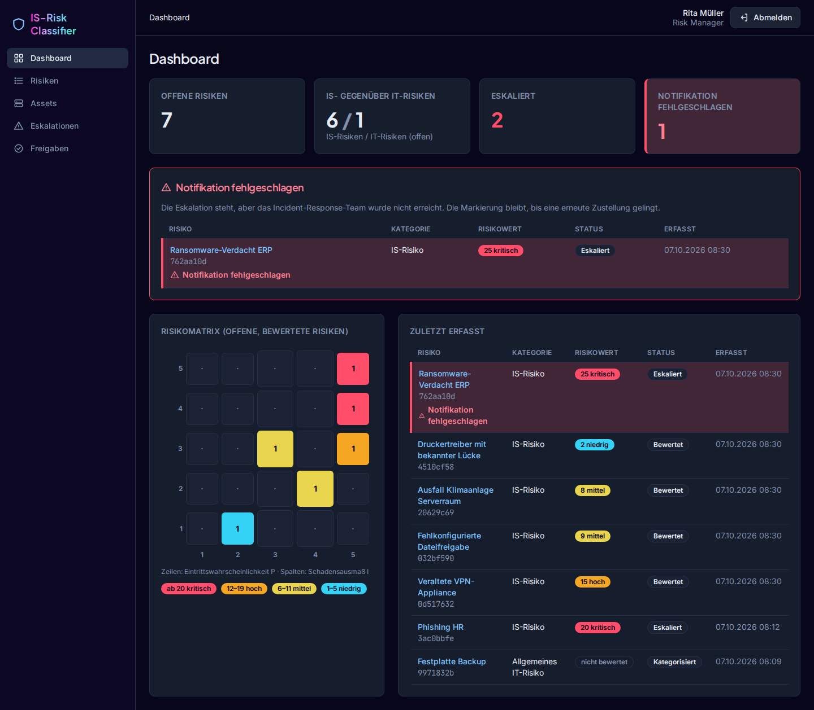

# IS-Risk Classifier

Leichtgewichtiges Risikoregister: trennt IT-Risiken von Informationssicherheitsrisiken
(IS-Risiken) anhand von Schutzzielen und Ursprung, berechnet den Risikowert R = P × I und eskaliert
kritische IS-Risiken an das Incident-Response-Team.

## Start

Voraussetzung: Docker mit Compose und `make`. Alles andere läuft in Containern.

```bash
git clone git@github.com:mwagner86/is-risk-classifier.git && cd is-risk-classifier
```

```bash
make dev
```

Danach <http://localhost:8000> öffnen. Beim ersten Start legt `make dev` die Datei `.env` mit
zufälligen Geheimnissen an. Das Passwort der Demo-Konten steht dort unter `DEMO_USER_PASSWORD`.

| Konto | Rolle |
| --- | --- |
| `melder` | Risikomelder (NUTZER) |
| `rm.mueller`, `rm.schmidt` | Risk Manager — zwei, für das Vier-Augen-Prinzip (M-04) |
| `ciso` | CISO |
| `app-admin` | Administration |
| `ohne-rolle` | keine Rolle — die Anmeldung wird abgelehnt |

## Befehle

| Befehl | Wirkung |
| --- | --- |
| `make dev` | Stack bauen und starten (App, Worker, Stylesheet, PostgreSQL, Keycloak) |
| `make css` | Stylesheet einmalig minifiziert bauen |
| `make test` | Tests gegen PostgreSQL, Filter mit `make test ARGS="-k m_05"` |
| `make lint` | ruff (Lint und Format) und mypy (strict) |
| `make fmt` | Formatierung und sichere Korrekturen anwenden |
| `make migrations` | Migrationen nach Modelländerungen erzeugen |
| `make lock` | `uv.lock` nach Änderungen an `pyproject.toml` neu auflösen |
| `make logs` / `make down` | Logs verfolgen / Stack anhalten, Daten bleiben |
| `make reset` | Stack anhalten und **Datenbank- und Keycloak-Volumes löschen** |

Änderungen an `docker/keycloak/realm-is-risk.json` wirken erst nach `make reset`, weil Keycloak einen
vorhandenen Realm beim Import nicht überschreibt.

## Aufbau

| Dienst | Aufgabe | Erreichbar |
| --- | --- | --- |
| `web` | Django-Anwendung | `127.0.0.1:8000` |
| `worker` | verschickt Notifikationen aus der Warteschlange (bis Iteration 6 über einen Mock) | — |
| `css` | baut das Stylesheet mit dem Tailwind-CLI neu, sobald sich Templates ändern | — |
| `keycloak` | Identity Provider (OIDC mit PKCE), Rollen aus Gruppen | `127.0.0.1:8080` |
| `db` | PostgreSQL, im internen Netz ohne Route nach außen | nur `web` |
| `test`, `tools` | Testlauf, Lint, Lockfile (Profil `tools`) | — |

```text
├── src/                    Anwendungscode (auf PYTHONPATH)
│   ├── manage.py
│   ├── config/             Einstellungen, URLs, WSGI
│   ├── apps/
│   │   ├── core/           Basismodell (UUID, Zeitstempel, kein Löschen), Zugriffsschutz, DB-Trigger
│   │   ├── accounts/       Benutzer, Rollen, Anmeldung über Keycloak
│   │   ├── risks/          Risiko, Bewertung, CIA-Triade, Freigabeanträge, Zustandsmaschine
│   │   ├── cmdb/           Assets, CSV-Import, Beispieldaten
│   │   ├── notifications/  Notifikationen: Warteschlange, Gateway (Mock), Worker
│   │   └── audit/          Audit-Log, nur anfügbar
│   └── templates/
├── tests/                  pytest; jeder Test trägt seine Anforderung: @pytest.mark.req("M-05")
├── docker/                 Dockerfile, Keycloak-Realm
├── docs/                   Spezifikation, Screenshots
└── Makefile, compose.yaml, pyproject.toml, uv.lock, .env.example
```

## Ansicht



Dunkles Thema nach dem Stil von dependencytrack.org: Kennzahlen, Risikomatrix 5 × 5, Badges je
Risikostufe (ab 20 kritisch, 12–19 hoch, 6–11 mittel, 1–5 niedrig). Ein Risiko mit fehlgeschlagener
Notifikation bleibt rot markiert, mit Symbol und Text, bis eine erneute Zustellung gelingt; die
Administration stößt sie unter **Eskalationen** an.

## Ablauf ausprobieren

1. Als `melder` ein Risiko erfassen. Wer nur „Verfügbarkeit“ und „Technisches Versagen /
   Verschleiß“ wählt, bekommt einen Antrag auf IT-Einordnung; bis zur Freigabe gilt das Risiko als
   IS-Risiko (M-04).
2. Als `rm.mueller` unter **Risiken** bewerten. Ein IS-Risiko ab 20 wird sofort eskaliert, der
   Worker meldet den Versand in `make logs`.
3. Als `rm.schmidt` (oder `rm.mueller` für Anträge anderer) unter **Freigaben** entscheiden.
4. Gateway-Ausfall (AK-03.3) nachstellen: in `.env` `NOTIFY_MOCK_MODE=timeout` setzen,
   `docker compose up -d worker`, dann ein IS-Risiko mit 4 × 5 bewerten.

## Sicherheitsrelevante Festlegungen

- **INV-03:** Kein Datensatz wird physisch gelöscht. Die ORM-Methoden werfen einen Fehler, und
  PostgreSQL-Trigger lehnen `DELETE` und `TRUNCATE` ab, auch bei direktem SQL.
- **M-05:** Jede Ansicht muss ihre erlaubten Rollen angeben (`@allow_roles`) oder ausdrücklich
  öffentlich sein (`@public`). Ansichten ohne Angabe werden mit 403 abgelehnt. Eine Anmeldung ohne
  genau eine Rollengruppe in Keycloak wird abgewiesen.
- **M-06:** Das Audit-Log ist per Trigger nur anfügbar, `UPDATE` und `DELETE` scheitern in der
  Datenbank.
- **M-02:** Abhängigkeiten sind exakt gepinnt (`uv.lock` mit Hashes), Basis-Images per Digest,
  htmx und die Schriften liegen lokal mit Prüfsumme (`src/static/THIRD_PARTY.md`).
- **M-04:** Eine Einordnung als IT-Risiko und eine Herabstufung unter 20 sind Anträge. Wirksam
  werden sie erst, wenn ein anderer Risk Manager zustimmt (auch als Prüfregel in der Datenbank).
- **M-09:** Eskalationen enthalten nur die Kennung und einen Link, der eine Anmeldung verlangt.
