# IS-Risk Classifier

Leichtgewichtiges Risikoregister: trennt IT-Risiken von Informationssicherheitsrisiken
(IS-Risiken) anhand von Schutzzielen und Ursprung, berechnet den Risikowert R = P × I und eskaliert
kritische IS-Risiken an das Incident-Response-Team.

## Start

Voraussetzung: Docker mit Compose und `make`. Alles andere läuft in Containern.

```bash
git clone git@github.com:mwagner86/is-risk-classifier.git && cd is-risk-classifier
```

```bash
make dev
```

Danach <http://localhost:8000> öffnen. Beim ersten Start legt `make dev` die Datei `.env` mit
zufälligen Geheimnissen an. Das Passwort der Demo-Konten steht dort unter `DEMO_USER_PASSWORD`.

| Konto | Rolle |
| --- | --- |
| `melder` | Risikomelder (NUTZER) |
| `rm.mueller`, `rm.schmidt` | Risk Manager — zwei, für das Vier-Augen-Prinzip (M-04) |
| `ciso` | CISO |
| `app-admin` | Administration |
| `ohne-rolle` | keine Rolle — die Anmeldung wird abgelehnt |

## Befehle

| Befehl | Wirkung |
| --- | --- |
| `make dev` | Stack bauen und starten (App, Worker, Stylesheet, PostgreSQL, Keycloak) |
| `make css` | Stylesheet einmalig minifiziert bauen |
| `make prod` / `make prod-down` | produktionsnaher Stack: Laufzeit-Image mit gunicorn, Debug aus, schreibgeschützt |
| `make sbom` | SBOM im CycloneDX-Format nach `sbom/is-risk-classifier.cdx.json` |
| `make audit` | Laufzeit-Abhängigkeiten gegen bekannte Schwachstellen prüfen (pip-audit) |
| `make trace` | Nachweistabelle Anforderung → Tests nach `docs/traceability.md` |
| `make messages` | Oberflächentexte einsammeln, englische Übersetzungen eintragen, Katalog kompilieren |
| `make test` | Tests gegen PostgreSQL, Filter mit `make test ARGS="-k m_05"` |
| `make lint` | ruff (Lint und Format) und mypy (strict) |
| `make fmt` | Formatierung und sichere Korrekturen anwenden |
| `make migrations` | Migrationen nach Modelländerungen erzeugen |
| `make lock` | `uv.lock` nach Änderungen an `pyproject.toml` neu auflösen |
| `make logs` / `make down` | Logs verfolgen / Stack anhalten, Daten bleiben |
| `make reset` | Stack anhalten und **Datenbank- und Keycloak-Volumes löschen** |

Änderungen an `docker/keycloak/realm-is-risk.json` wirken erst nach `make reset`, weil Keycloak einen
vorhandenen Realm beim Import nicht überschreibt.

## Aufbau

| Dienst | Aufgabe | Erreichbar |
| --- | --- | --- |
| `web` | Django-Anwendung | `127.0.0.1:8000` |
| `worker` | verschickt Notifikationen aus der Warteschlange über `notify-gateway` | — |
| `notify-gateway` | Platzhalter für den externen E-Mail-/SMS-Anbieter: E-Mail an Mailpit, SMS ins Log; Ausfall per `NOTIFY_FAILURE_MODE` erzwingbar | nur `worker` |
| `mailpit` | fängt alle E-Mails ab, Weboberfläche | `127.0.0.1:8025` |
| `css` | baut das Stylesheet mit dem Tailwind-CLI neu, sobald sich Templates ändern | — |
| `pdf-renderer` | erzeugt die PDF-Exporte; eigener Prozess ohne Datenbanknetz und ohne Zugangsdaten, Dateisystem schreibgeschützt | nur `web` |
| `keycloak` | Identity Provider (OIDC mit PKCE), Rollen aus Gruppen | `127.0.0.1:8080` |
| `migrate` | einmalig als Datenbank-Eigentümer: Migrationen, eingeschränkte Anwendungsrolle, CMDB-Beispieldaten | — |
| `db` | PostgreSQL, im internen Netz ohne Route nach außen | nur `web`, `worker`, `migrate` |
| `test`, `tools` | Testlauf, Lint, Lockfile (Profil `tools`) | — |

```text
├── src/                    Anwendungscode (auf PYTHONPATH)
│   ├── manage.py
│   ├── config/             Einstellungen, URLs, WSGI
│   ├── apps/
│   │   ├── core/           Basismodell (UUID, Zeitstempel, kein Löschen), Zugriffsschutz, DB-Trigger
│   │   ├── accounts/       Benutzer, Rollen, Anmeldung über Keycloak
│   │   ├── risks/          Risiko, Bewertung, CIA-Triade, Freigabeanträge, Zustandsmaschine
│   │   ├── cmdb/           Assets, CSV-Import, Beispieldaten
│   │   ├── notifications/  Notifikationen: Warteschlange, HttpGateway (und Mock für Tests), Worker
│   │   ├── exports/        CSV- und PDF-Export (gefiltert, gekennzeichnet)
│   │   └── audit/          Audit-Log, nur anfügbar, und seine Ansicht
│   ├── pdf_renderer/       eigenständiger PDF-Dienst ohne Django und ohne Datenbanktreiber
│   ├── notify_gateway/     eigenständiger Benachrichtigungsdienst (Platzhalter für den Anbieter)
│   └── templates/
├── tests/                  pytest; jeder Test trägt seine Anforderung: @pytest.mark.req("M-05")
│   ├── assets/             Tailwind-Quelle mit den Design-Tokens (wird nicht ausgeliefert)
├── tools/                  SBOM-Erzeugung
├── docker/                 Dockerfile (dev, runtime), Keycloak-Realm
├── docs/                   Spezifikation, Screenshots, Nachweistabelle
└── Makefile, compose.yaml, compose.prod.yaml, pyproject.toml, uv.lock, .env.example
```

## Oberfläche

Dunkles Thema nach dem Stil von dependencytrack.org, auf Deutsch (Standard) und Englisch. Die
Aufnahmen zeigen die englische Oberfläche mit Beispieldaten; Asset-Namen kommen aus der deutschen
CMDB-Beispieldatei und bleiben deshalb deutsch.

### Dashboard

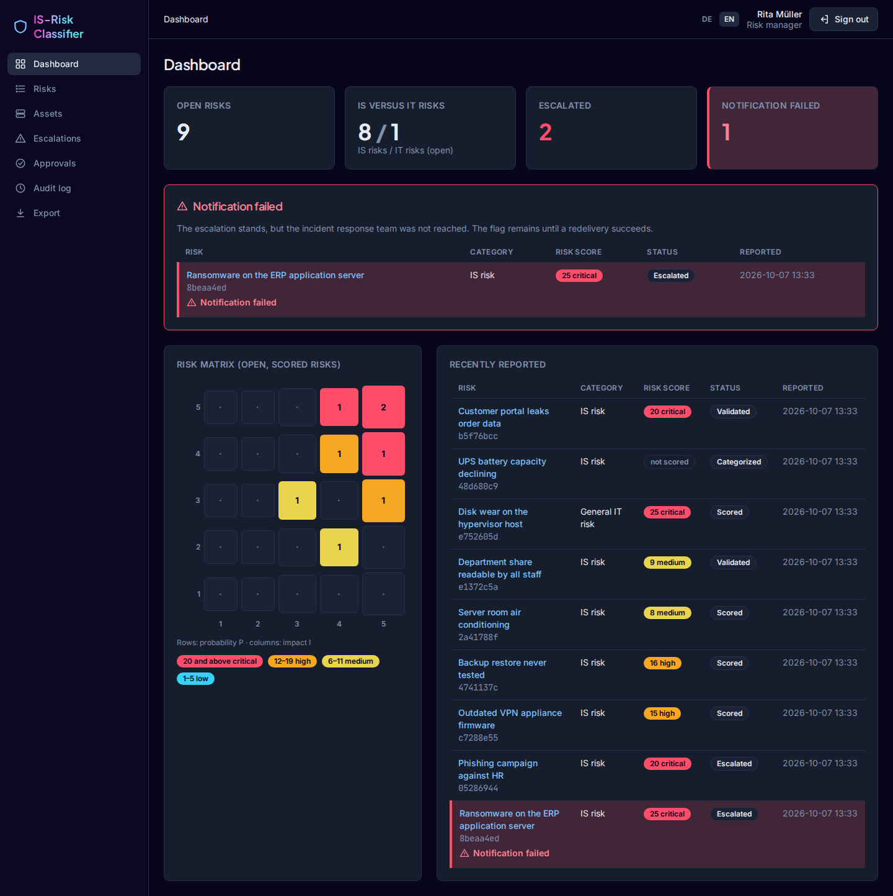

Kennzahlen, Risikomatrix 5 × 5 (ein Klick auf eine Zelle filtert die Risikoliste) und Badges je
Risikostufe: ab 20 kritisch, 12–19 hoch, 6–11 mittel, 1–5 niedrig. Ein Risiko, dessen Eskalation
das Incident-Response-Team nicht erreicht hat, bleibt rot markiert, mit Symbol und Text, bis eine
erneute Zustellung gelingt (AK-03.3).

### Risiko erfassen (US-01)

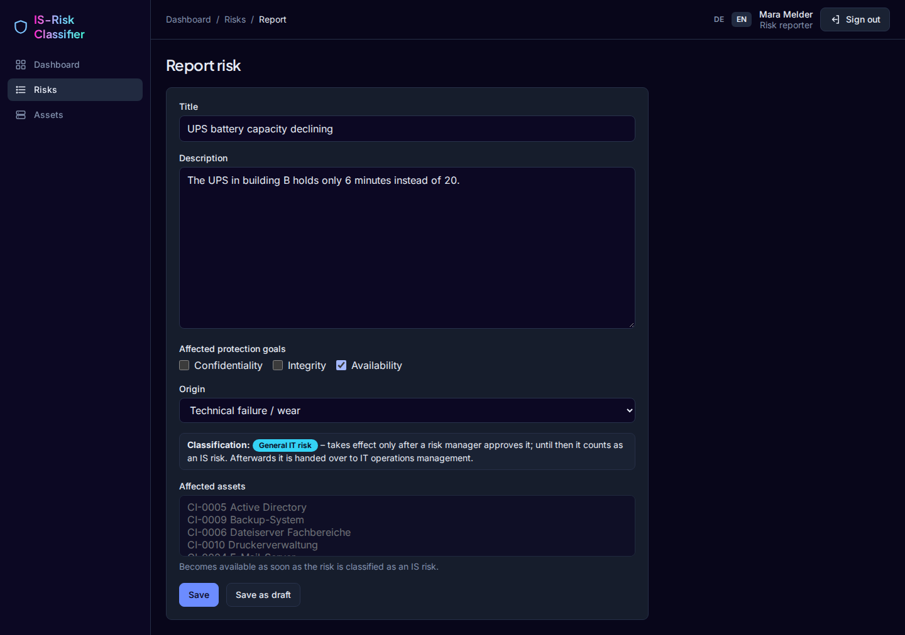

Die Einstufung erscheint schon beim Ausfüllen. Hier: nur Verfügbarkeit und technisches Versagen
ergeben ein IT-Risiko, das erst nach Freigabe durch einen Risk Manager wirksam wird (M-04); das Feld
„Affected assets“ bleibt gesperrt, bis die Eingaben ein IS-Risiko ergeben.

### Risiko im Detail

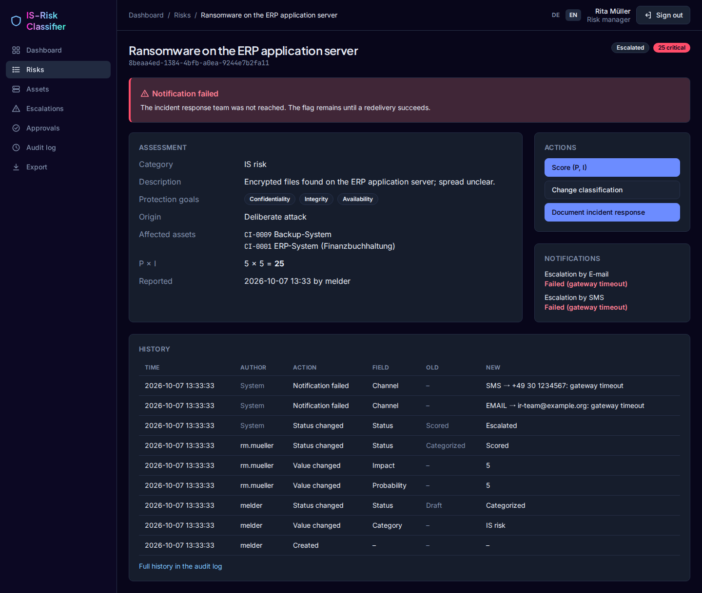

Bewertung, Aktionen je Rolle, Notifikationen mit Zustellstatus und der Verlauf aus dem Audit-Log.

### Bewerten (US-02)

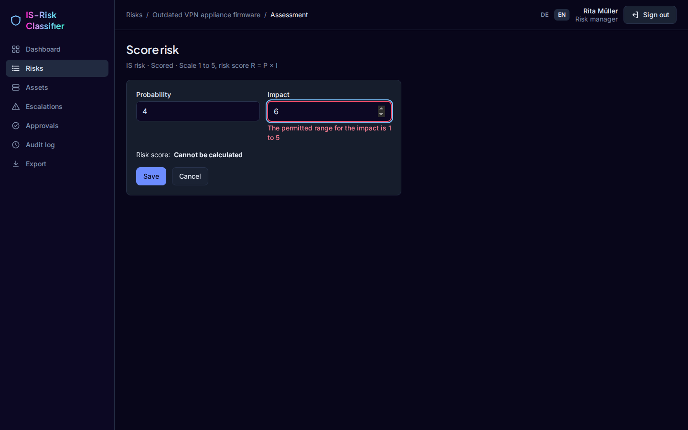

Werte außerhalb von 1 bis 5 weist der Server ab; die Meldung nennt die Dimension, der Risikowert
zeigt „Cannot be calculated“.

### Weitere Seiten

| | |
| --- | --- |
| 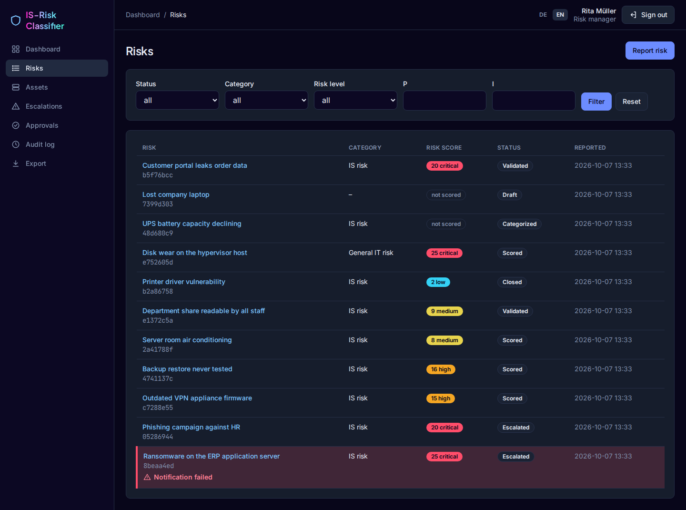 | 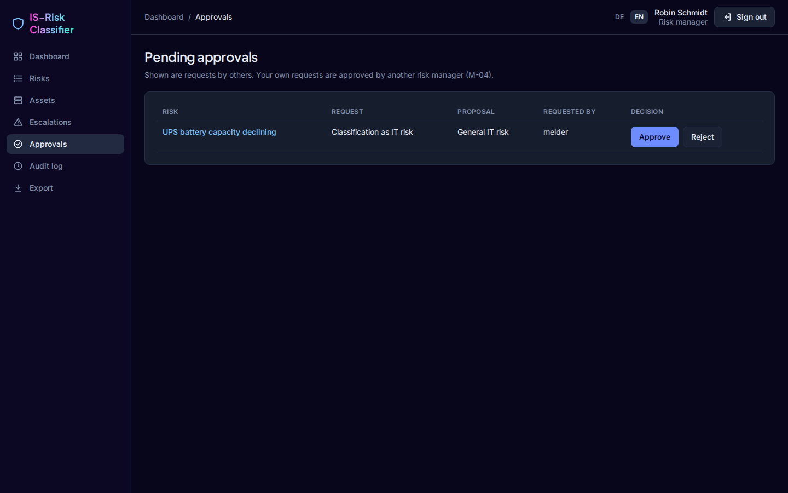 |
| Risikoliste mit Filtern | Freigaben: Anträge anderer, nie die eigenen (M-04) |
| 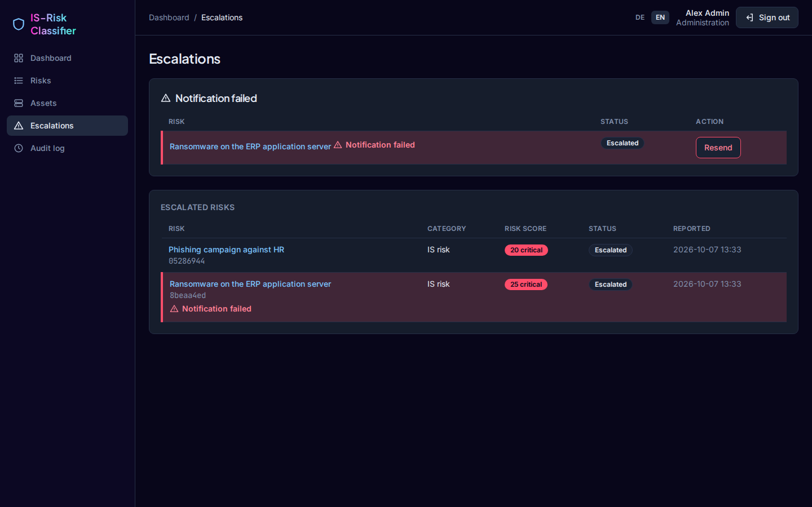 | 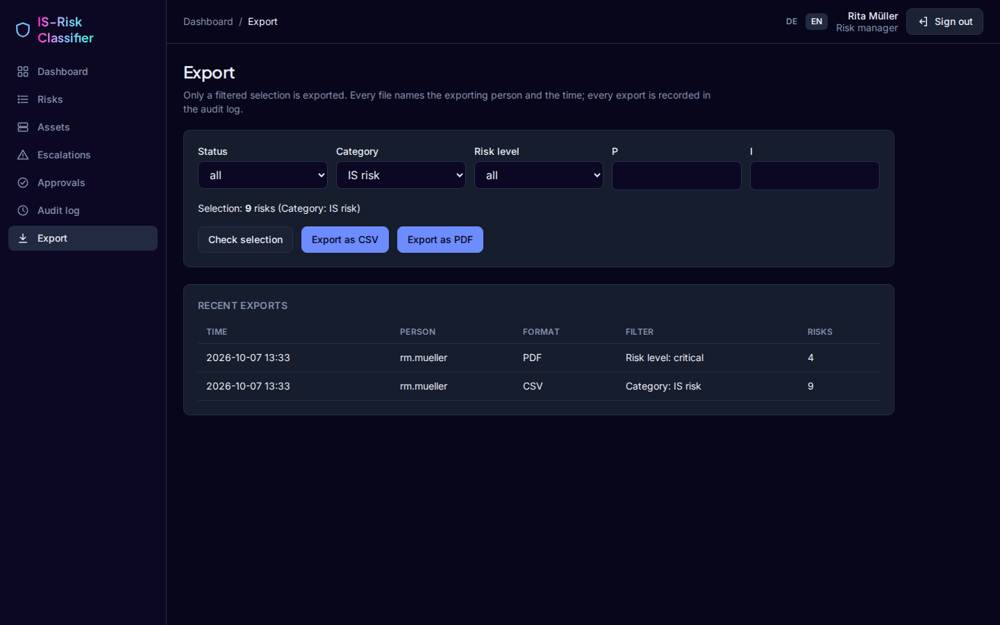 |
| Eskalationen: erneut senden nur durch die Administration | Export nur mit Filter, jede Datei gekennzeichnet (M-07, M-08) |
| 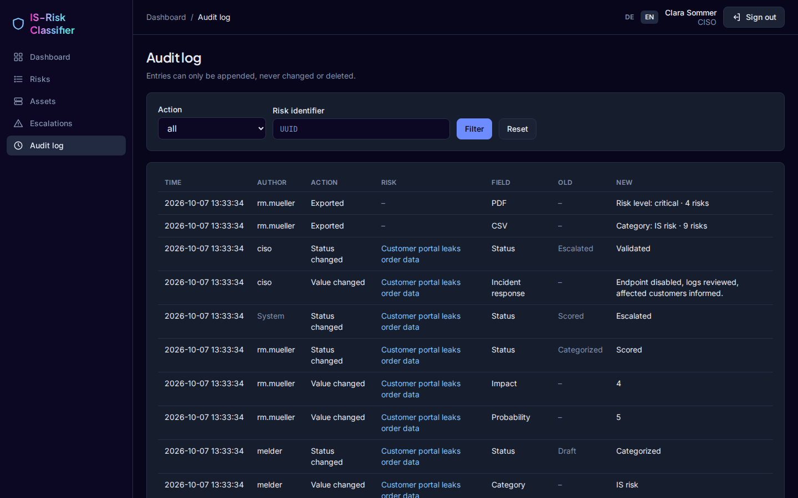 | 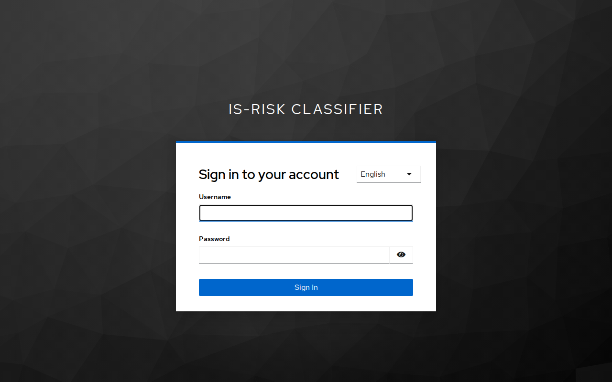 |
| Audit-Log, nur anfügbar (M-06) | Anmeldung über Keycloak in der gewählten Sprache |
| 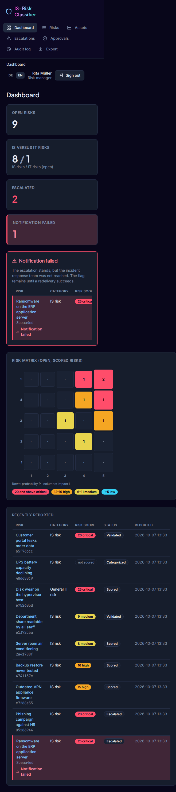 | 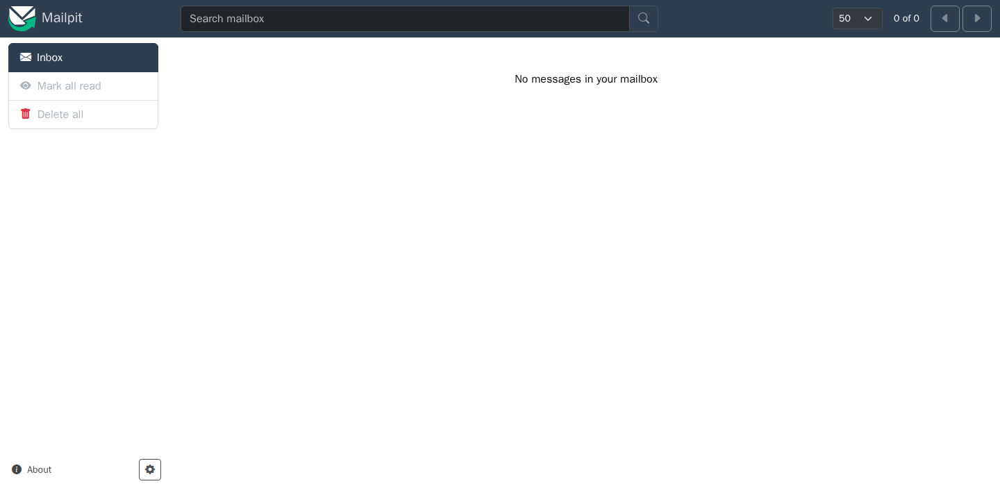 |
| Dashboard auf dem Handy | Eskalationsmail in Mailpit: nur Kennung und Link (M-09) |

Ein PDF-Export auf Englisch liegt als Beispiel unter
[`docs/screenshots/en/export-example.pdf`](docs/screenshots/en/export-example.pdf).

## Sprache

Umgeschaltet wird oben rechts mit **DE** / **EN**. Die Wahl bleibt in einem Cookie gespeichert; ohne
Wahl entscheidet die Sprache des Browsers. Die Anmeldeseite von Keycloak folgt der gewählten Sprache,
CSV- und PDF-Exporte ebenfalls. Deutsch ist die Quellsprache: Die Meldungen der Spezifikation stehen
dort wörtlich. Die Benachrichtigungen an das Incident-Response-Team bleiben deutsch.

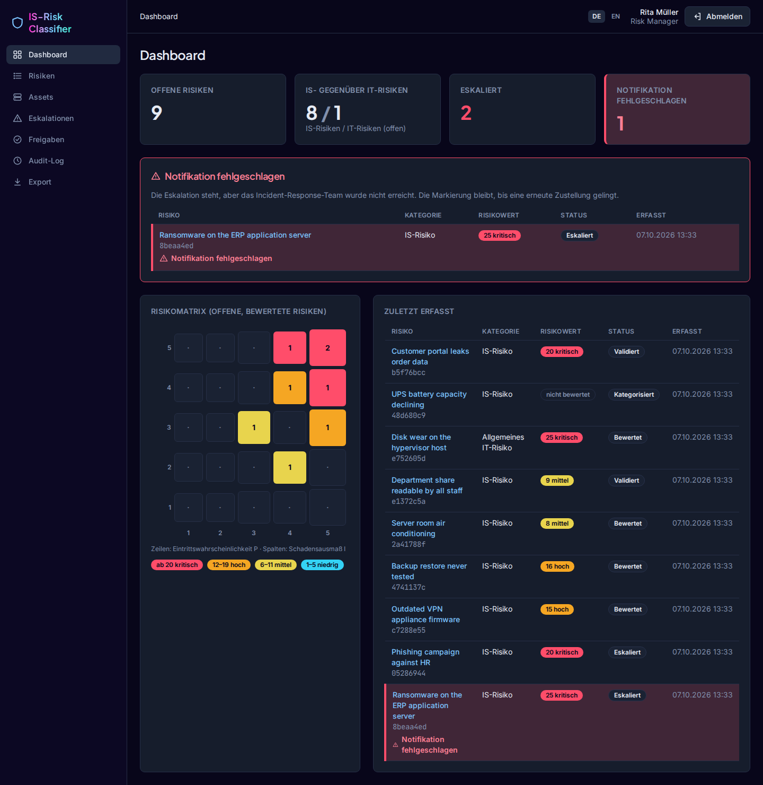

## Ablauf ausprobieren

1. Als `melder` ein Risiko erfassen. Wer nur „Verfügbarkeit“ und „Technisches Versagen /
   Verschleiß“ wählt, bekommt einen Antrag auf IT-Einordnung; bis zur Freigabe gilt das Risiko als
   IS-Risiko (M-04).
2. Als `rm.mueller` unter **Risiken** bewerten. Ein IS-Risiko ab 20 wird sofort eskaliert; die
   E-Mail an das Incident-Response-Team erscheint in Mailpit (<http://localhost:8025>), die SMS im
   Log des Gateways (`docker compose logs notify-gateway`). Sie enthält nur Kennung und Link (M-09).
3. Als `rm.schmidt` (oder `rm.mueller` für Anträge anderer) unter **Freigaben** entscheiden.
4. Als Risk Manager unter **Export** filtern und als CSV oder PDF exportieren. Ohne Filter wird
   nicht exportiert; jeder Export erscheint im **Audit-Log**.
5. Gateway-Ausfall (AK-03.3) nachstellen: in `.env` `NOTIFY_FAILURE_MODE=timeout` (oder `5xx`)
   setzen, `docker compose up -d notify-gateway`, dann ein IS-Risiko mit 4 × 5 bewerten. Das Risiko
   bleibt rot markiert. Nach `NOTIFY_FAILURE_MODE=none` und erneutem `docker compose up -d
   notify-gateway` stellt `app-admin` unter **Eskalationen** die Notifikation erneut zu.

## Laufende Prüfung

GitHub Actions führt bei jedem Push, bei Pull Requests und jeden Montag Lint, Tests, die Prüfung
der Nachweistabelle, `make audit` und `make sbom` aus; die SBOM liegt als Artefakt am Lauf.
Dependabot schlägt wöchentlich Updates für Python-Pakete, Docker-Images und Actions vor.

## Sicherheitsrelevante Festlegungen

- **INV-03:** Kein Datensatz wird physisch gelöscht. Die ORM-Methoden werfen einen Fehler, und
  PostgreSQL-Trigger lehnen `DELETE` und `TRUNCATE` ab, auch bei direktem SQL.
- **M-05:** Jede Ansicht muss ihre erlaubten Rollen angeben (`@allow_roles`) oder ausdrücklich
  öffentlich sein (`@public`). Ansichten ohne Angabe werden mit 403 abgelehnt. Eine Anmeldung ohne
  genau eine Rollengruppe in Keycloak wird abgewiesen.
- **M-06:** Das Audit-Log ist per Trigger nur anfügbar, `UPDATE` und `DELETE` scheitern in der
  Datenbank.
- **M-02:** Abhängigkeiten exakt gepinnt (`uv.lock` mit Hashes), Images per Digest, Tailwind-CLI
  per Prüfsumme, htmx und Schriften lokal mit Prüfsumme (`src/static/third_party.json`).
  `make sbom` erzeugt die SBOM (CycloneDX 1.5: Python-Pakete, Front-End-Dateien, Images),
  `make audit` prüft gegen bekannte Schwachstellen.
- **INV-03 / M-06 auch in der Datenbank:** Die Anwendung verbindet sich mit einer eigenen Rolle
  ohne `DELETE`, `TRUNCATE` und DDL; das Audit-Log darf sie nur ergänzen. Sie kann die Trigger
  nicht entfernen. Migrationen laufen getrennt als Eigentümer (Dienst `migrate`).
- **M-05 im HTTP-Layer:** Content-Security-Policy ohne `unsafe-inline`/`unsafe-eval` (htmx ohne
  `eval`), weitere Sicherheits-Header, angemeldete Seiten mit `no-store`, Sitzungen höchstens
  8 Stunden. Hinter einem TLS-Proxy schaltet `DJANGO_HTTPS=true` sichere Cookies, HSTS und
  Umleitung ein; `manage.py check --deploy` läuft dann ohne Befund.
- **M-04:** Eine Einordnung als IT-Risiko und eine Herabstufung unter 20 sind Anträge. Wirksam
  werden sie erst, wenn ein anderer Risk Manager zustimmt (auch als Prüfregel in der Datenbank).
- **M-09:** Eskalationen enthalten nur die Kennung und einen Link, der eine Anmeldung verlangt.
- **M-01:** Eingaben erreichen ReportLab nur maskiert; Markup in Titel oder Beschreibung erscheint
  als Text (getestet auch mit der Nutzlast von CVE-2023-33733).
- **M-03:** Das PDF erzeugt der Dienst `pdf-renderer` im Netz `pdf` ohne Route zur Datenbank, ohne
  Zugangsdaten, mit schreibgeschütztem Dateisystem und ohne Capabilities.
- **M-07 / M-08:** Export nur für Risk Manager und nur mit Filter; jede Datei nennt Person und
  Zeitpunkt (CSV je Zeile, PDF auf jeder Seite und in den Metadaten, Dateiname). Jeder Export steht
  im Audit-Log.
- **T-04:** Zellen, die mit `=`, `+`, `-`, `@`, Tab oder Wagenrücklauf beginnen, werden im CSV mit
  einem Apostroph entschärft.
