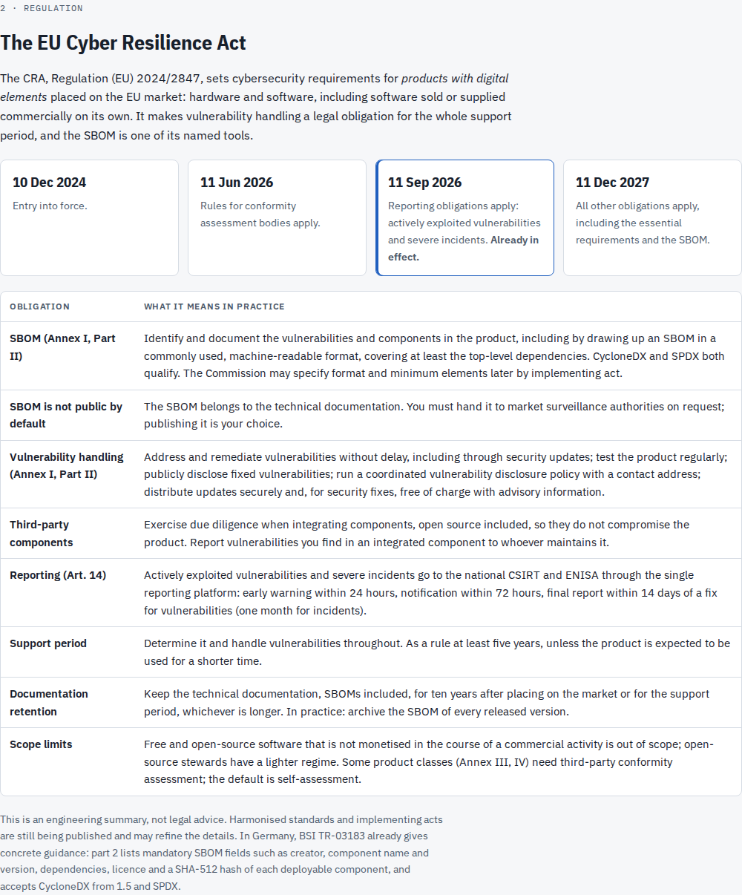
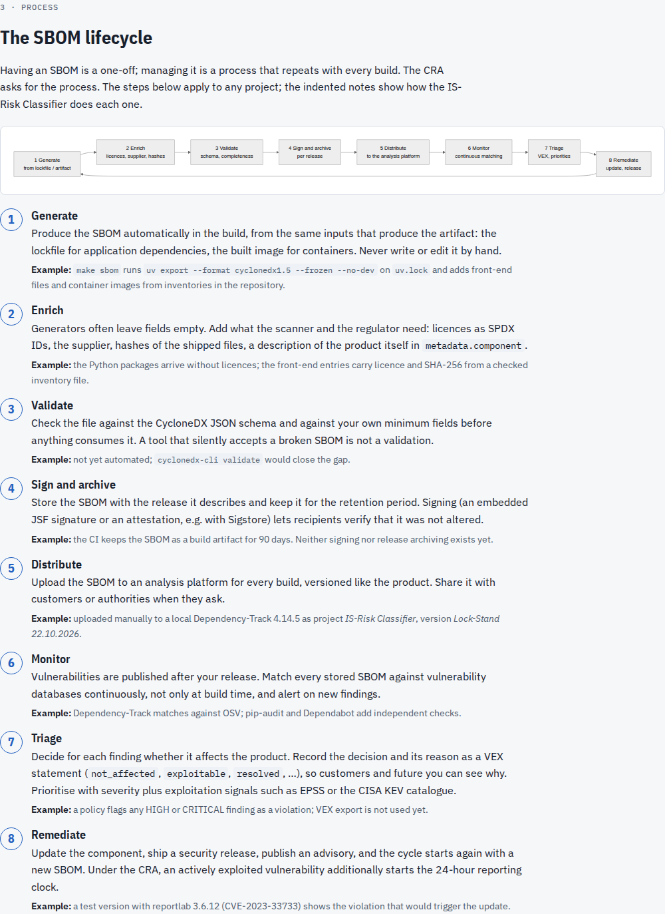
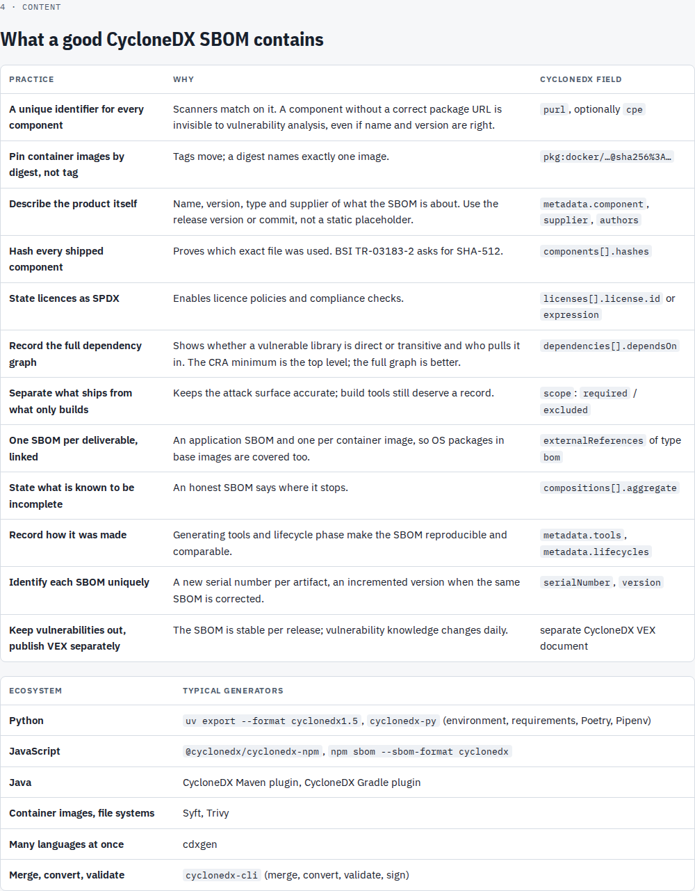
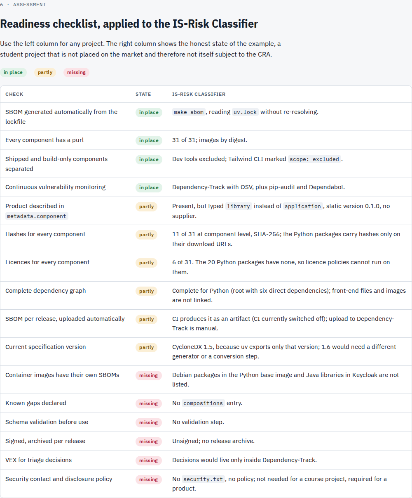
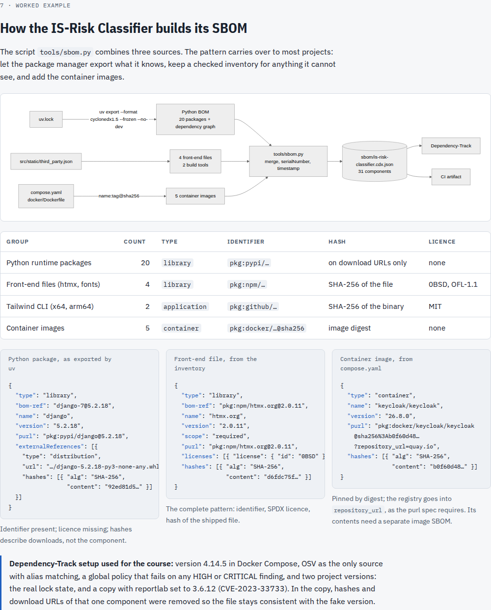
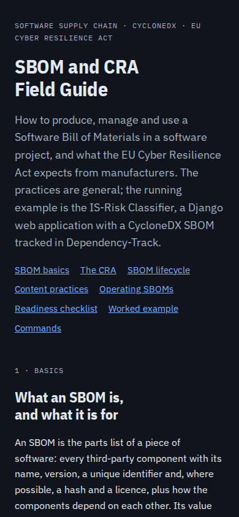

# SBOM and CRA Field Guide

A standalone guide on producing and managing Software Bills of Materials (SBOMs) in CycloneDX and on
what the EU Cyber Resilience Act (CRA) expects from manufacturers. The practices are general; the
IS-Risk Classifier serves as the running example.

**Open the guide:** [`sbom-and-cra-field-guide.html`](sbom-and-cra-field-guide.html) — download or
clone the repository and open the file in a browser. GitHub shows HTML files as source code only.
The two diagrams are drawn by Mermaid, loaded from a CDN, so they need network access; everything
else works offline. The page follows the light or dark setting of the system.

## Contents

| Section | What it covers |
| --- | --- |
| 1 · SBOM basics | What an SBOM is, CycloneDX versus SPDX, what an SBOM does not do |
| 2 · The CRA | Timeline, SBOM obligation, vulnerability handling, third-party components, 24/72-hour reporting, support period, retention |
| 3 · SBOM lifecycle | Generate, enrich, validate, sign and archive, distribute, monitor, triage, remediate |
| 4 · Content practices | What a good CycloneDX SBOM contains and why, typical generators per ecosystem |
| 5 · Operating SBOMs | Platform and automation, responsibilities, disclosure policy, rehearsing the reporting path |
| 6 · Readiness checklist | Reusable checks, applied to the IS-Risk Classifier |
| 7 · Worked example | How `make sbom` assembles this project's SBOM from three sources |
| 8 · Commands | `jq` checks, schema validation, image SBOMs with Syft, upload to Dependency-Track |

## Screenshots

### Overview

### The Cyber Resilience Act

### The SBOM lifecycle

### Content practices

### Readiness checklist

### Worked example

### Phone, dark theme

## Notes

- **As of 23 October 2026.** The CRA summary is an engineering overview, not legal advice;
  harmonised standards and implementing acts may refine the details.
- **The example reflects commit `990d5c3`.** Numbers such as 31 components describe the SBOM of
  that state; `make sbom` produces the current one.
- **A private copy is published as a Claude Artifact.** This file in the repository is the version
  under source control; changes to one do not reach the other.
